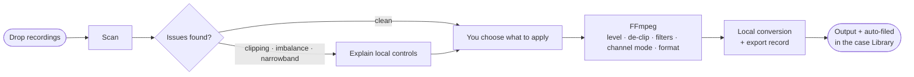

# DepoAudio

**Desktop audio converter and reviewer for court reporters and anyone with difficult recordings.**

Open and convert proprietary court-recording formats, improve levels and clipping, review recordings, and keep cases organized. Recording processing stays on the device.

[](../../actions/workflows/ci.yml)    

[**Download**](../../releases/latest) · [Website](https://depoaudio.com) · [Install guide](https://depoaudio.com/install/) · [Changelog](CHANGELOG.md) · [Report a bug](../../issues)

---

## What it does

> **Release truth:** the download link serves published v1.0.2, the latest
> public release. This branch prepares unpublished v1.2.0, which replaces the
> never-published v1.1.0. v1.2.0 is not downloadable until published: its
> private candidate, installers, approvals and public release must first be
> independently verified
> ([`docs/V1.2.0-RELEASE-CANDIDATE.md`](docs/V1.2.0-RELEASE-CANDIDATE.md)).

DepoAudio handles the audio side of a deposition or hearing, end to end:

- **Convert** court formats (Stenograph SGMCA, FTR `.trm`/`.ftr`/`.tll`, DigitalCAT `.dm`, Liberty / BIS `.dcr`, CourtSmart BWF), standard audio and the audio track of video files to WAV, MP3, FLAC, Opus, M4A or SGMCA (Direct Audio): mix to stereo, keep the channel layout, or split one file per channel and name each by its microphone.
- **Improve** audio with local, non-learned controls: microphone-channel leveling, clipped-peak repair, high-pass filter, loudness normalization, leading-silence trim and fades.
- **Proof and listen** in the Player: follow an existing transcript against the audio, flag lines for review, rewind a little on resume, and solo or mute single microphones while you listen.
- **Organize** every conversion into an auto-filed case library, and pull recordings straight from installed court software.

> **Recordings stay local.** Conversion, playback, analysis and cleanup run on your machine; audio is not uploaded. Optional update checks may use the network. No account or subscription is required. v1.2.0 has no learned-model ("AI") processing and does not install or download model files; local AI is Planned for v2.

---

## Download

| Platform          | Download                                                           |
| ----------------- | ------------------------------------------------------------------ |
| **macOS** 13.3+   | Universal `.dmg`: one download runs on Apple Silicon **and** Intel |
| **Windows** 10/11 | `.msi` installer (or the `-setup.exe` installer)                   |

**[Get the latest release](../../releases/latest)**

> Code signing, notarization and signed updater artifacts are enabled only when their credentials are configured. v1.2.0 is planned to ship unsigned, so macOS and Windows will warn the first time you open it, and it has no in-app updates: install each new version over the old one. Check each published release's notes for its signing and update state before installing.

---

## How it works



Scanning is a bounded, cancellable local analysis pass. FFmpeg performs the selected non-learned signal controls, output format and channel layout. Recording processing remains local.

---

## Features

### Conversion

- **Court and standard formats** in, six formats out (WAV · MP3 · FLAC · Opus · M4A · SGMCA Direct Audio)
- **Three output modes**: mix to stereo, keep original, or split by channel
- **Per-channel** labels and volume
- **Batch** the whole session at once
- **Presets** named for where the file is going (CATalyst audio sync, other CAT software, scopist, one file per microphone, archive, smallest file), each with the reason for its format; a preset sets only the channel mode and format, never processing
- **Compare with original**: switch between a converted file and its source at the same position

### Signal cleanup (local, non-learned)

- **Scan** measures channel loudness, peaks, clipping, balance and sample rate; loudness, peaks and clipping come from the first 3 minutes of each file
- **Scan suggests, you decide**: suggested fixes are marked Recommended and nothing changes until you apply them
- **Auto-level** balances per-channel loudness from a bounded representative sample
- **De-clip** distorted peaks, apply a high-pass filter, normalize, trim leading silence, or add fades
- **Live progress** with a Cancel button; analysis and sidecar operations use bounded samples, timeouts and cancellation paths

### Player and proofing

- **Three panes**: playlist and bookmarks on the left, the transcript in the centre, Now Playing with the waveform, listening mix and flags on the right; resize or hide the side panes
- **Proof a transcript against this recording**: open an existing SRT, WebVTT or timestamped text transcript (for example an ASCII export from your CAT software). The line at the playhead is highlighted and followed; click a line or press Enter to play from it. Adjust the sync if the transcript is ahead or behind, enter the recording's start time for time-of-day stamps, and press F to flag a line for review with a note. Flags export as CSV or text. DepoAudio does not edit transcripts; make corrections in your CAT software
- Color-coded tracks, **0.5×–2× speed**, **A-B loop**, editable **bookmarks**, full keyboard transport

### Listening tools

- **Backstep**: go back 1, 2, 3 or 5 seconds when you resume (Off until you choose)
- **Volume** control, saved like playback speed
- **Separate channels**: a strip per microphone with Mute, Solo and 0–200% volume. These change what you hear only, never the converted files
- **Playback keys** (off by default): control the Player from chosen keys while you type in CAT software or a word processor, with Hold to play for press-and-hold pedals that send keys

### Safety for legal audio

- **An export record beside every output** (`<output>.depoaudio.json`): source and output names (never folders), SHA-256 of both, the app version, the exact FFmpeg filters and encoder settings, the converted audio track and the recording start time when there is one. Schema: [`docs/export-manifest.schema.json`](docs/export-manifest.schema.json)
- **The audio stays in place**: no added delay, Trim stops at the first sample above the threshold and the export record says how many samples it removed, Keep Original refuses MP3, M4A or Opus that would lose channels, and every step names the first audio track. A conversion that would move or drop audio is refused with a message
- **The original is never changed**; temporary copies go in a private per-run work folder that is cleared at every launch
- **Your data**: Settings shows where DepoAudio keeps its data, and lets you back up, restore or clear all of it. DepoAudio does not encrypt local data itself, so keep full-disk encryption on ([`docs/LOCAL-DATA.md`](docs/LOCAL-DATA.md))
- **Copy diagnostics** copies the app version, operating system, processor type and FFmpeg version only; error messages, file names and folder paths are never included

### Library and detection

- **Case library**: auto-filed by case, with search, archive, inline play and re-export
- **Court-software detection**: Case CATalyst, FTR Gold, Eclipse, DigitalCAT, CourtSmart
- **Import jobs** straight from detected directories

### General

- **Dark and light** themes (system-aware), in the DepoStack design with the bundled Archivo and Fragment Mono typefaces (no font is fetched from the network)
- **Updates**: v1.0.2 cannot update itself, so install v1.2.0 by downloading it. Later versions can always be downloaded from GitHub Releases; DepoAudio installs an update itself only from a release that carries a verified update signature

---

## Supported formats

Status words: **Available** (in this release), **Preview** (works, but tested with synthetic samples only; check the output before relying on it), **Planned** (not in this release).

| Format                                        | Vendor                     | Status       |
| --------------------------------------------- | -------------------------- | ------------ |
| **SGMCA** (single session)                    | Stenograph · Case CATalyst | Available    |
| **SGMCA** multi-session reading, SGMCA output | Stenograph · Case CATalyst | Preview      |
| **FTR / TRM / TLL**                           | For The Record             | Preview      |
| **BWF**                                       | CourtSmart · Various       | Available    |
| **DigitalCAT / SoundSync (.dm)**              | Stenovations               | Preview      |
| **DCR**                                       | Liberty / BIS Digital      | Preview      |
| **WAV, MP3, FLAC, M4A, OGG, Opus, WMA, AIF**  | Standard                   | Available    |
| **Video (MP4, MOV, MKV, AVI, WebM)**          | Audio track extracted      | Available    |
| **Video (MPG, VOB, TS, MTS, M2TS, WMV, ASF)** | Audio track extracted      | Preview      |
| **Learned-model (AI) cleanup and analysis**   | —                          | Planned (v2) |

**Closed formats: export to WAV first.** DepoAudio recognizes these files but does not open them. When you add one, it names the software to export it with.

| Format                      | Vendor              | What to do                                                                                                |
| --------------------------- | ------------------- | --------------------------------------------------------------------------------------------------------- |
| **AES (Eclipse AudioSync)** | Eclipse CAT         | Encrypted: in Eclipse, File → Export Audio → WAV                                                          |
| **DS2 (DSS Pro)**           | OM System / Olympus | Export to WAV in ODMS (with its password if encrypted)                                                    |
| **ARF / WRF**               | Cisco Webex         | ARF to MP4 with the Webex Recording Converter, WRF to WMV with the Webex WRF2WMV Converter (Windows only) |
| **MSV / DVF**               | Sony IC recorder    | Convert to WAV with Sony Digital Voice Editor (no longer offered for download)                            |

The MPG, VOB, TS, MTS, M2TS, WMV and ASF rows are smoke-tested at each
release with synthetic files carrying MP2, AC-3 or WMAv2 audio. No real
deposition recording in these containers has been tried yet.

**FTR (Preview).** FTR recordings are read as the owner's interoperability notes describe them:
one AAC stream per microphone (format tag 0x4180) or stereo streams of two
microphones (0x8180), split by DepoAudio when FFmpeg's native FTR decoder
cannot take the file as it is. FTR AAC without either flag is refused, as
FTR's own player refuses it. The recording's start (its TLOC, TUTC or FILE
time) goes into WAV outputs' BWF start time; the user name and free-text
chunks are never copied, only noted as present. This has been checked with
synthetic files and with one sample made by the owner's rebuild tool
(`scripts/fixtures/trm/vendor-notes-samples/`), not with a recording made by
FTR.

**SGMCA (multi-session and output in Preview).** An SGMCA (Direct Audio) file can hold several recording sessions; DepoAudio
reads every one and joins them in order (the gaps between them are not
kept), and SGMCA files it writes carry the Direct Audio file and segment
headers with each session's start time. That layout comes from
owner-supplied interoperability notes and has not yet been confirmed
against a file CATalyst wrote, nor has CATalyst been shown to open a file
DepoAudio wrote. See [`docs/SGMCA.md`](docs/SGMCA.md).

**DCR (Preview).** DCR support reads Liberty / BIS Digital recordings and has been tested with
synthetic files only, including two synthetic tones the owner made with a
rebuild tool. The layout it reads comes from owner-supplied interoperability
notes and has not been confirmed against a recording made by the vendor's
software (see `docs/DCR.md`). Redactions marked in the recording are applied:
skipped segments are left out and blacked-out ones are silent.
Password-protected sections are silent in the output, with a warning before
export. The recording's checksums are checked and the result is shown.
Speex audio, other unknown codecs and recordings whose layout DepoAudio cannot
follow are refused with a message; export those to WAV in the software that
recorded them. A `.dcr` without the Liberty / BIS Digital signature gets
export guidance, and a camera raw image named `.dcr` is called out as an
image.

**DigitalCAT / SoundSync `.dm` (Preview).** DepoAudio reads the audio inside into a
temporary WAV for FFmpeg, skips blocks that were recorded over, keeps the
audio in file order and stops at a short block, where the notes say
SoundSync's player stops; anything left out is reported. A `.bmf` marker file
beside it is counted in the export record, without its text. It has been
tested with synthetic files only, built from owner-supplied notes on the
layout ([`docs/formats/dm.md`](docs/formats/dm.md)) that have not yet been
checked against a file SoundSync recorded.

---

## Learned-model boundary

No AI or learned-model processing in v1.2.0; local AI is Planned for v2. The history of the public `models-v1` release, which v1.0.2 can still reference, is in [`THIRD_PARTY_LICENSES.md`](THIRD_PARTY_LICENSES.md#historical-model-inventory-and-non-distribution-boundary).

---

## Development

### Prerequisites

- [Rust](https://rustup.rs/) 1.90+ · [Node.js](https://nodejs.org/) 22.12+ · [Tauri CLI](https://v2.tauri.app/start/prerequisites/) (`cargo install tauri-cli`)
- Windows builds also require Visual Studio 2022 Build Tools with the **Desktop development with C++** workload and a Windows SDK; Rust's MSVC target needs their `link.exe` and import libraries.

### FFmpeg sidecars

Place FFmpeg/FFprobe binaries in `src-tauri/binaries/` with target-triple names (not committed):

| Platform    | Files                                                                     |
| ----------- | ------------------------------------------------------------------------- |
| macOS ARM   | `ffmpeg-aarch64-apple-darwin`, `ffprobe-aarch64-apple-darwin`             |
| macOS Intel | `ffmpeg-x86_64-apple-darwin`, `ffprobe-x86_64-apple-darwin`               |
| Windows x64 | `ffmpeg-x86_64-pc-windows-msvc.exe`, `ffprobe-x86_64-pc-windows-msvc.exe` |

For local development, `scripts/setup-dev.sh` can stage system FFmpeg binaries;
confirm the staged build exposes the native `ftr` decoder. Release sidecars are
created only by the reviewed, hash-pinned release workflow.

### Run & build

```bash
npm ci
npm run tauri dev     # develop
npm run tauri build   # package installers
```

### Quality gates

`npm run ci:local` runs every check below in CI order, stops on the first
failure, and writes a JSON evidence file to `.ci-evidence/`. It needs
`cargo-deny`, the Tauri system libraries, and an `ffmpeg`/`ffprobe` on `PATH`
(it stages them as temporary sidecars and removes them afterwards). The
individual commands are:

```bash
npm run release:check
npm run lint
npm run format:check
npm test
npm run build
npm run size:check
cargo test --locked --manifest-path src-tauri/Cargo.toml
cargo deny --manifest-path src-tauri/Cargo.toml --locked --all-features check bans licenses sources
gitleaks git --no-banner --redact --exit-code 1 --log-opts=--all .   # skipped by ci:local if not installed
```

The deterministic size check protects the emitted desktop frontend from accidental JavaScript or CSS growth. Rust
license, source, and dependency policy lives in [`deny.toml`](deny.toml). Native binaries and installer payloads require
the separate evidence ledger in [`THIRD_PARTY_LICENSES.md`](THIRD_PARTY_LICENSES.md); a green Cargo check is not
redistribution clearance for those artifacts. The release check also proves the compiled application graph of the version being released,
packaged resources, active setup paths, and user interface contain no learned-model distribution or execution path.
The proposed packaged-app automation remains deferred until
its dependency graph passes the documented gate in [`docs/PACKAGED-APP-TESTING.md`](docs/PACKAGED-APP-TESTING.md).

Hosted CI also runs weekly on `main`, so an expiring exception or a new advisory turns it red without a push. GitHub
turns off scheduled workflows on a public repository after 60 days with no repository activity, and nothing here
notices when that happens. Until the platform alerting follow-up checks that the CI workflow is still enabled, the
release owner should confirm it on the Actions page (or with `gh workflow list --all`, where its state then reads
`disabled_inactivity`) and re-enable it after a quiet spell; `npm run ci:local` gives the same result at any time.

### Project layout

```
src/                     # React 19 frontend
  components/
    Convert/  Player/  Library/  common/  ui/
    Merge/               # Merge tab: sync and merge two to four recordings
  hooks/                 # theme, prefs, conversion
  lib/                   # player, proofing, waveform, local-data helpers
  App.jsx                # app shell: sidebar nav (Convert · Player · Library) and Settings
src-tauri/               # Rust backend (Tauri 2)
  src/
    analysis.rs          # bounded non-learned Scan observations
    dm.rs bmf.rs         # DigitalCAT / SoundSync .dm reader, .bmf marker counts (Preview)
    dcr.rs               # Liberty / BIS Digital .dcr reader (Preview)
    trm.rs               # FTR layout reader and channel splitter (Preview)
    sgmca.rs             # SGMCA Direct Audio reader and writer
    workdir.rs           # private per-run work folder for temporary audio
    conversion.rs        # validated local FFmpeg conversion pipeline
    ffmpeg.rs            # sidecar + filter chain      merge.rs / merge_engine.rs (Merge)
    manifest.rs          # <output>.depoaudio.json export record
    models.rs            # deletion-only cleanup of model files left by v1.0.2
    catdetect.rs         # court-software detection     safety.rs / helpers.rs
    localdata.rs         # Your data: storage list, zip backup/import, clear all
    commands.rs types.rs persistence.rs
  binaries/              # FFmpeg/FFprobe sidecars (not committed)
  resources/third-party/ # deterministic bundled dependency notices
.github/workflows/       # CI + release builds
```

**Stack:** Tauri 2 · Rust · React 19 · Vite · FFmpeg

See [`PARITY.md`](PARITY.md) for the full capability/contract inventory that the characterization tests pin.

---

## Releasing

After the intended release commit is merged to `main`, dispatch the release workflow with a tag matching `version` in `src-tauri/tauri.conf.json`:

```bash
gh workflow run release.yml --ref main -f tag=vX.Y.Z -f windows_runner=self-hosted
```

GitHub Actions verifies the private-candidate contract and creates one commit-bound **private draft** before building. A retry may reuse that draft only when it is still empty, bound to the exact same commit, and retains the canonical name, changelog notes, and prerelease state; stale, populated, altered, or duplicate same-tag drafts fail closed for manual reconciliation. The workflow regenerates commit-bound dependency evidence, builds a **universal macOS** `.dmg` and both **Windows** installers, tests the extracted downloadable containers, and routes every installer and evidence upload through a helper that rechecks the exact draft ID, tag, source commit, private state, and asset-name uniqueness. The Tauri action runs in build-only mode with no release ID, tag, or GitHub token, so it cannot replace release assets. Signing, notarization, and updater signatures are enabled independently only when their complete credential sets are present.

> **The build workflow never publishes.** Its last job requires the exact MSI, NSIS EXE, DMG, versioned universal app archive, inventories, source evidence, notices, SBOMs, and toolchain record to remain on the same private draft. GitHub requires release-level token access even to read that draft, so that job's inline audit receives `contents: write`; the release contract rejects upload, edit, delete, and publish commands in that job. It rejects `latest.json`; signed updater metadata belongs to a separate publication-approval step after exact-asset installation tests. Do not use GitHub's manual Publish button while any entry in the release gate (`docs/V<version>-RELEASE-GATE.json`, currently [`docs/V1.2.0-RELEASE-GATE.json`](docs/V1.2.0-RELEASE-GATE.json)) is open.

### Release signing configuration (one-time)

Without platform-signing credentials, private candidates contain an ad-hoc-signed macOS app and unsigned Windows installers. Without a verified updater keypair, the release overlay omits the updater endpoint and generates no updater signatures. Neither state is publication approval; record and accept the exact artifact state through the release gate. Local/development builds intentionally contain no updater key or endpoint.

1. **Generate a keypair** (keep the private key safe — losing it means you can't ship updates):
   ```bash
   npx tauri signer generate -w ~/.tauri/depoaudio.key
   ```
2. **Add updater secrets**: `TAURI_SIGNING_PRIVATE_KEY`, `TAURI_SIGNING_PRIVATE_KEY_PASSWORD` if set, and `TAURI_UPDATER_PUBLIC_KEY`. The workflow injects the public key and canonical DepoStack update endpoint into release builds only.
3. **Add macOS secrets**: `APPLE_CERTIFICATE`, `APPLE_CERTIFICATE_PASSWORD`, `APPLE_SIGNING_IDENTITY`, `APPLE_ID`, `APPLE_PASSWORD`, and `APPLE_TEAM_ID`.
4. **Add Windows secrets**: `WINDOWS_CERTIFICATE` (the PFX encoded as base64), `WINDOWS_CERTIFICATE_PASSWORD`, and `WINDOWS_CERTIFICATE_THUMBPRINT`.

If a key is lost or may be compromised, follow [`docs/RUNBOOK-SIGNING-KEYS.md`](docs/RUNBOOK-SIGNING-KEYS.md). To pull or replace a published release, follow [`docs/RUNBOOK-BAD-RELEASE.md`](docs/RUNBOOK-BAD-RELEASE.md).

The private-candidate workflow scopes signing credentials to packaging, removes the imported Windows private key before executing candidate binaries, and uploads generated signatures through the verified draft helper. It deliberately does not generate or publish `latest.json`, and it never publishes the draft. The manual [`publish-release.yml`](.github/workflows/publish-release.yml) workflow first supports a read-only manifest inspection, then permits publication only from a protected `release-publication` environment after the committed gate binds the exact draft, assets, source and approval commits, updater decision, and current UTC release date. It never rebuilds, deletes, or replaces an installer, and it never creates or moves a tag. One person can complete a release: instead of a second reviewer, the workflow requires a wait timer of at least 24 hours on `release-publication` that administrators cannot bypass (deploying only from `main`), an active tag ruleset that restricts creating, moving, and deleting `v*` tags, and a signed annotated release tag at the exact source commit that GitHub reports as verified and whose tagger is the release owner email recorded in the gate. Those are dashboard settings the release owner makes by hand; the workflow reads them back and fails before any release write. Who is on the tag ruleset's bypass list is the one setting the workflow cannot fully check. Follow the exact [candidate-to-publication runbook](docs/V1.2.0-RELEASE-CANDIDATE.md#exact-candidate-to-publication-sequence).

---

## License

[MIT](LICENSE) © Andrew Mayes
